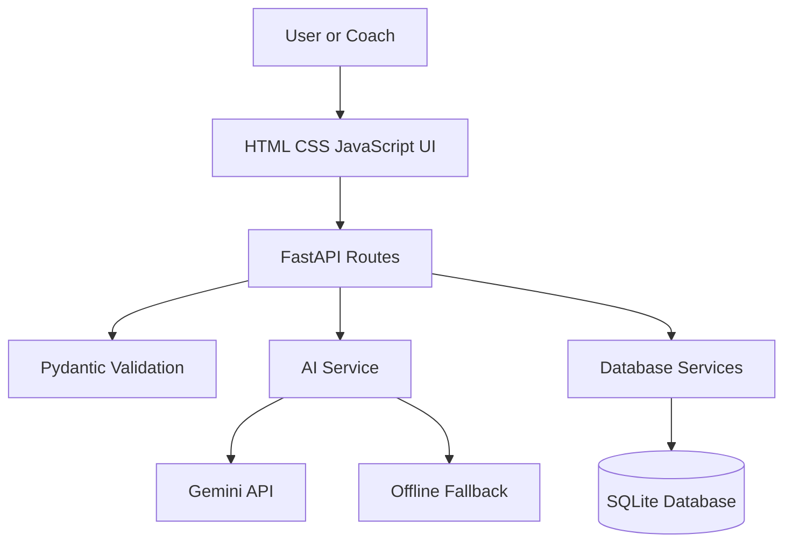
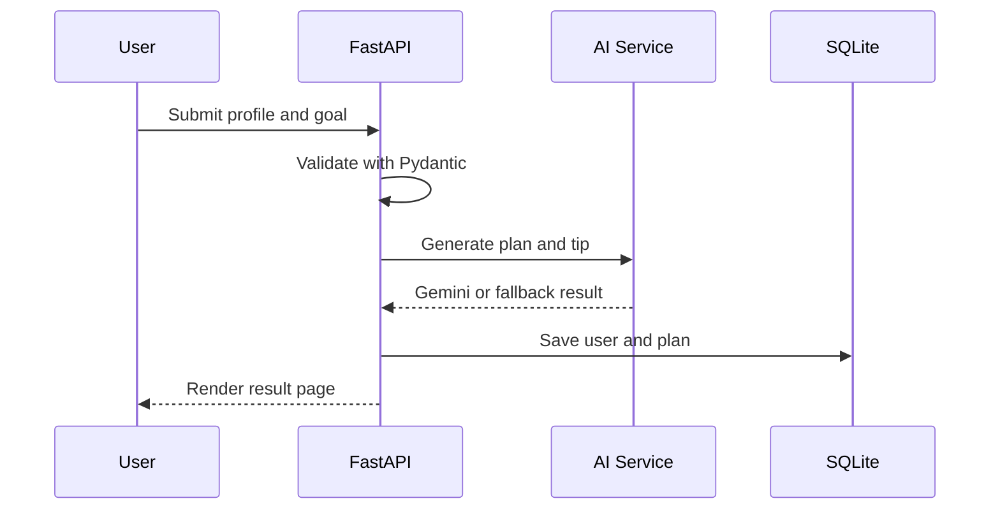
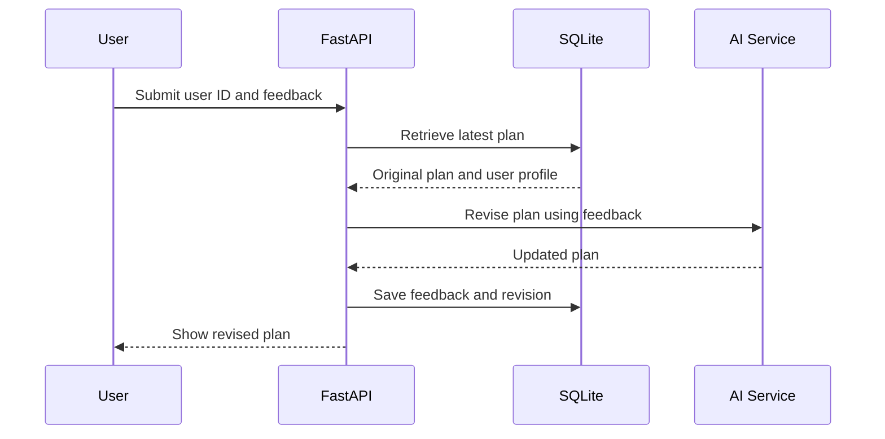
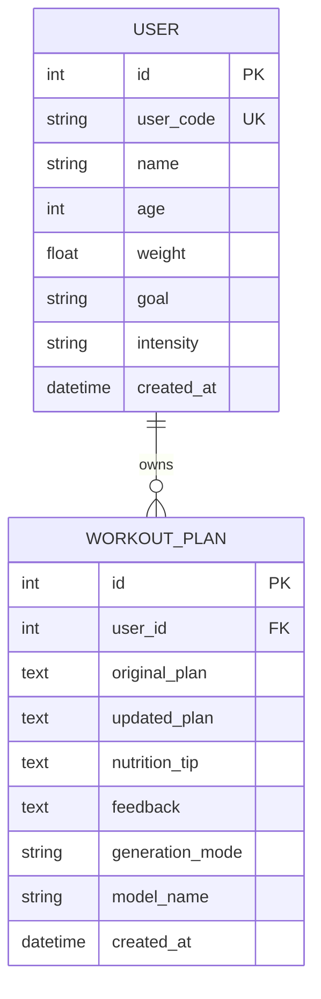

# Phase 3 Project Design

## Design objective

FitBuddy uses a modular web architecture so the user interface, routing, AI generation, validation, and persistence can be understood and tested separately.

## System architecture

## Component responsibilities

| Component | Responsibility |
|---|---|
| `main.py` | Create the FastAPI app, initialize the database, mount static files, and register routes |
| `routes.py` | Handle HTML and JSON requests and return templates or API responses |
| `schemas.py` | Validate and normalize workout and feedback inputs |
| `ai_service.py` | Build prompts, call Gemini, generate fallback plans, and apply feedback |
| `services.py` | Create/update database records and perform queries |
| `database.py` | Configure SQLAlchemy, define entities, and manage sessions |
| `config.py` | Read environment variables and expose application settings |
| `templates` | Render home, result, admin, and error pages |
| `static` | Provide responsive styling and small browser interactions |

## Request flow

### Generate plan

### Update from feedback

## Data design

## Route design

| Method | Path | Input | Output |
|---|---|---|---|
| GET | `/` | None | Plan generation form |
| POST | `/generate-workout` | Form fields | Result page |
| POST | `/submit-feedback` | User ID and feedback | Revised result page |
| GET | `/view-all-users` | None | Admin dashboard |
| GET | `/api/health` | None | JSON status |
| POST | `/api/workouts` | JSON workout request | JSON plan response |
| POST | `/api/feedback` | JSON feedback request | JSON revised plan |
| GET | `/docs` | None | Interactive OpenAPI documentation |

## User interface design

### Home page

- Clear title and explanation
- Status badge showing Gemini or demo mode
- Six-field plan form
- Segmented intensity selection
- Responsive weekly preview card
- Feature summary

### Result page

- User goal, intensity, and ID summary
- Seven-day plan with copy and print actions
- Nutrition/recovery card
- Feedback form
- Original-plan comparison after an update

### Admin page

- User identity and profile
- Goal and intensity
- Number of stored plans
- Latest mode and update status

## Visual design system

- Primary colors: navy, blue, cyan, and violet
- Neutral background: very light blue-gray
- Typography: system sans-serif for interface and monospace for plans
- Components: rounded cards, clear borders, high-contrast buttons, consistent spacing
- Responsive breakpoints: desktop, tablet, and mobile

## AI design

The AI service receives only validated fields. Prompts request a seven-day structure, balanced recovery, plain-text output, and a safety note. The model name is configured through `GEMINI_MODEL`, allowing the project to adapt to current Gemini availability without source-code changes.

The fallback path is intentionally deterministic. It proves all required application flows while preventing an absent API key from blocking the demonstration.

## Security design

- API key is loaded from `.env` or environment variables.
- `.env` is excluded by `.gitignore`.
- Input lengths and numeric ranges are bounded.
- Basic markup characters are rejected in free text.
- Database queries use SQLAlchemy rather than concatenated SQL.
- HTML is rendered with Jinja2 auto-escaping.
- No API key is returned to templates or JSON responses.

## Safety design

Fitness guidance is general. Both live and fallback prompts avoid diagnosis and include a pain/health-concern notice. A production deployment would add user authentication, stricter rate limiting, professional review, and formal privacy controls.
